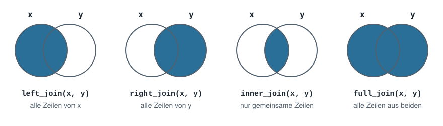
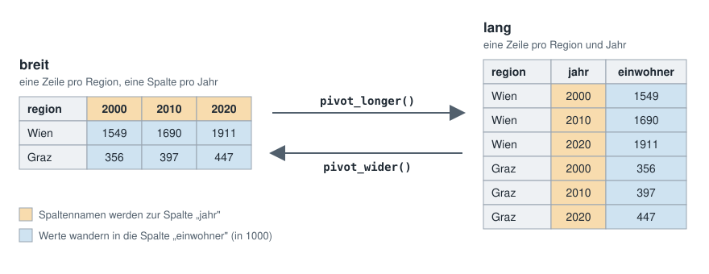

```{r setup, include=FALSE}
knitr::opts_chunk$set(echo = TRUE, message = FALSE)
options(width = 110)   # breite Tabellen nicht umbrechen
```

In dieser Einheit lernst du:

1. **Datenbearbeitung mit `dplyr`** — filtern, sortieren, neue Spalten berechnen, gruppieren,
   verbinden, umformen
2. **Visualisierung mit `ggplot2`** — Grafiken schichtweise aufbauen

Falls noch nicht geschehen, einmalig **in der Console** installieren:
`install.packages(c("dplyr", "tidyr", "ggplot2"))`.

```{r}
library(dplyr)     # Daten bearbeiten
library(tidyr)     # Tabellen umformen
library(ggplot2)   # Grafiken
```

Wir arbeiten mit den Gemeinde-Daten aus Einheit 3 (bei Ischgl fehlt der Preis — darauf kommen
wir mehrmals zurück):

```{r}
gemeinden     <- read.csv("data/raw/gemeinden.csv")
bundeslaender <- read.csv("data/raw/bundeslaender.csv")
```


# Teil 1: Datenbearbeitung mit dplyr

`dplyr` bündelt typische Arbeitsschritte in gut lesbare Funktionen („Verben"). Jedes Verb
bekommt einen Data Frame und gibt einen neuen zurück.

## filter() — Zeilen auswählen

```{r}
filter(gemeinden, preis_m2 > 400)
filter(gemeinden, typ %in% c("Stadt", "Umland"), entfernung_km <= 20)
```

Zeilen, bei denen die Bedingung `NA` ergibt (hier: Ischgl), fallen weg.

## select() — Spalten auswählen

Ein Minus schließt Spalten aus:

```{r}
select(gemeinden, gemeinde, bundesland, einwohner)
select(gemeinden, -c(gkz, entfernung_km))
```

## arrange() — sortieren

`desc()` dreht die Reihenfolge um:

```{r}
arrange(gemeinden, desc(preis_m2))
```

## Der Pipe-Operator: %>% und |>

Mehrere Schritte ohne Pipe heißt: verschachteln (von innen nach außen lesen) oder viele
Zwischenergebnisse speichern:

```{r}
arrange(filter(gemeinden, bundesland == "Tirol"), desc(preis_m2))
```

Die **Pipe** setzt das Ergebnis links als **erstes Argument** in die Funktion rechts ein. Man
liest sie als **„und dann"**: *Nimm `gemeinden`, und dann filtere nach Tirol, und dann sortiere
nach dem Preis.* Der Data Frame steht deshalb nicht mehr in der Klammer:

```{r}
gemeinden %>%
  filter(bundesland == "Tirol") %>%
  arrange(desc(preis_m2))
```

Es gibt zwei Schreibweisen, die sich in diesem Kurs **gleich** verhalten: `%>%` (kommt mit
`dplyr`, steht in den meisten Büchern) und `|>` (seit R 4.1 eingebaut). Du solltest beide
lesen können. Tastenkürzel: *Strg/Cmd + Shift + M*.

## mutate() — neue Spalten berechnen

`mutate()` berechnet eine neue Spalte für jede Zeile — wie
`gemeinden$dichte <- ...` in Basis-R:

```{r}
gemeinden <- gemeinden %>%
  mutate(dichte = round(einwohner / flaeche_km2))
```

## case_when() — Werte nach Bedingungen einteilen

Jede Zeile in `case_when()` hat die Form `bedingung ~ ergebnis`; die erste zutreffende gewinnt,
`TRUE ~` fängt alles Übrige auf:

```{r}
gemeinden <- gemeinden %>%
  mutate(preisniveau = case_when(
    is.na(preis_m2) ~ NA,          # fehlende Werte zuerst abfangen
    preis_m2 > 400  ~ "hoch",
    preis_m2 > 100  ~ "mittel",    # alles über 400 ist schon "hoch"
    TRUE            ~ "niedrig"    # alle übrigen Zeilen
  ))

filter(gemeinden, gemeinde == "Ischgl")
```

Ohne die erste Zeile würde Ischgl als `"niedrig"` eingestuft — die Vergleiche ergeben `NA`,
und dann greift `TRUE ~`.

## count(), group_by() + summarise() — Kennzahlen pro Gruppe

`count()` zählt, wie oft jeder Wert vorkommt — das `dplyr`-Gegenstück zu `table()`:

```{r}
gemeinden %>% count(bundesland)
```

`group_by()` + `summarise()` berechnet eine Kennzahl je Gruppe:

```{r}
gemeinden %>%
  group_by(bundesland) %>%
  summarise(
    anzahl        = n(),
    preis_mean    = mean(preis_m2),
    einwohner_max = max(einwohner)
  )
```

Bei Tirol steht `NA`, weil der Preis von Ischgl fehlt — `na.rm = TRUE` lässt ihn aus. Nach
mehreren Spalten gruppiert ergibt sich eine Zeile pro Kombination:

```{r}
gemeinden %>%
  group_by(bundesland, typ) %>%
  summarise(anzahl = n(), preis_mean = mean(preis_m2, na.rm = TRUE))
```

Die Meldung `summarise() has grouped output by 'bundesland'` ist nur ein Hinweis, kein Fehler.

::: {.callout-note title="Was ist ein Tibble?"}
Viele Funktionen aus `dplyr`, `tidyr` und `readxl` geben ein **Tibble** zurück — einen Data
Frame mit anderer Anzeige: Oben stehen Größe und Datentypen (`<chr>`, `<dbl>`), gezeigt werden
nur die ersten zehn Zeilen (alles: `View()`). Ein Unterschied beim Arbeiten:
`tabelle[, "spalte"]` liefert bei einem Tibble eine Tabelle, `tabelle$spalte` immer einen
Vektor. `as.data.frame()` wandelt um.
:::

## Datensätze verbinden: Joins

`bundeslaender` enthält zu jedem Bundesland die Region (Ost-, Süd- oder Westösterreich). Ein
**Join** hängt sie über die gemeinsame Spalte `bundesland` an `gemeinden` an.

Die Tabellen passen absichtlich nicht perfekt zusammen: **Vorarlberg** (Gemeinde Viktorsberg)
fehlt in `bundeslaender`, **Salzburg** hat keine Gemeinden im Datensatz.



```{r}
nrow(left_join(gemeinden, bundeslaender, by = "bundesland"))    # 28 — alle Gemeinden, Viktorsberg mit Region NA
nrow(inner_join(gemeinden, bundeslaender, by = "bundesland"))   # 27 — Viktorsberg fällt weg
nrow(full_join(gemeinden, bundeslaender, by = "bundesland"))    # 29 — dazu Salzburg ohne Gemeinde
```

`right_join()` behält alle Bundesländer. Meist will man keine Zeilen verlieren, deshalb ist
`left_join()` der Standard:

```{r}
gemeinden_join <- gemeinden %>%
  left_join(bundeslaender, by = "bundesland")

gemeinden_join %>% filter(is.na(region))
```

Über mehrere Spalten: `by = c("spalte1", "spalte2")`. In Basis-R heißt der Join `merge()`.

## Breite und lange Tabellen: pivot_longer() und pivot_wider()



- **breit:** eine Spalte pro Jahr. Gut zum Lesen, aber das Jahr steckt im **Spaltennamen** —
  R kann nicht danach filtern oder gruppieren.
- **lang:** eine Zeile pro Region **und** Jahr. Das Jahr ist eine eigene Spalte, mit der
  `filter()`, `group_by()` und `ggplot2` arbeiten können.

Faustregel: Stehen in den Spaltennamen **Werte** (Jahre, Monate, Kategorien), ist die Tabelle
breit.

Beispiel: ein Export aus der [ARDECO-Datenbank](https://urban.jrc.ec.europa.eu/ardeco) mit der
Bevölkerung europäischer Staaten und ihrer NUTS-3-Regionen — die Quelle auch für
Übungsaufgabe 1. Jedes Jahr ist eine Spalte; weil Spaltennamen nicht mit einer Ziffer
beginnen dürfen, hat `read.csv()` ein `X` davorgesetzt:

```{r}
bev_breit <- read.csv("data/raw/ardeco_bevoelkerung.csv")
dim(bev_breit)
bev_breit[1:3, c("TERRITORY_ID", "NAME_HTML", "X1960", "X1961", "X1962")]
```

`pivot_longer()` macht aus vielen Spalten zwei: eine für die bisherigen Spalten**namen**
(`names_to`, im Bild orange) und eine für die **Werte** (`values_to`, blau). `cols` wählt die
Spalten aus — wie bei `select()`:

```{r}
bev_lang <- bev_breit %>%
  pivot_longer(cols = starts_with("X"), names_to = "jahr", values_to = "einwohner",
               names_prefix = "X") %>%          # das X vor der Jahreszahl entfernen
  mutate(jahr = as.integer(jahr)) %>%           # "1960" (Text) -> 1960 (Zahl)
  select(TERRITORY_ID, NAME_HTML, jahr, einwohner)

dim(bev_lang)
head(bev_lang, 3)
```

`pivot_wider()` geht den umgekehrten Weg: Die Werte von `names_from` werden zu Spaltennamen,
`values_from` füllt die Zellen — praktisch, um Jahre nebeneinander zu vergleichen:

```{r}
bev_lang %>%
  filter(TERRITORY_ID %in% c("AT", "AT130"), jahr %in% c(1960, 1990, 2020)) %>%
  pivot_wider(names_from = jahr, values_from = einwohner, names_prefix = "einwohner_")
```

In älteren Skripten heißt `pivot_longer()` noch `gather()`.

### Übung

1. Zeige für die Tiroler Gemeinden `gemeinde`, `typ` und die Bevölkerungsdichte (gerundet),
   sortiert von der dichtesten zur dünnsten.
2. Verbinde `gemeinden` mit `bundeslaender` und berechne pro `region` die Anzahl Gemeinden und
   den durchschnittlichen Preis. Warum gibt es eine Gruppe `NA`?
3. Stelle aus `bev_lang` die Einwohner von 1990 und 2024 für Österreich (`AT`), Deutschland
   (`DE`) und die Schweiz (`CH`) nebeneinander. Um wie viel Prozent ist die Bevölkerung
   jeweils gewachsen?

```{r}
# dein Code

```


# Teil 2: Visualisierung mit ggplot2

## Die Daten vorbereiten

Ohne Preis kann `ggplot` keinen Punkt zeichnen und warnt bei jeder Grafik. Deshalb entfernen
wir Ischgl einmal vorab und geben `typ` eine sinnvolle Reihenfolge (Faktor, Einheit 2) — sonst
wird alphabetisch sortiert:

```{r}
gemeinden_plot <- gemeinden_join %>%
  filter(!is.na(preis_m2)) %>%
  mutate(typ = factor(typ, levels = c("Stadt", "Umland", "Land")))
```

## Der Grundaufbau

`ggplot2` baut Grafiken **schichtweise** mit `+` auf:

```
ggplot(daten, aes(x = ..., y = ...)) +   # Daten + welche Spalte auf welche Achse
  geom_...()                             # welche Form: Punkte, Balken, Linien …
```

## Streudiagramm: geom_point()

```{r}
ggplot(gemeinden_plot, aes(x = entfernung_km, y = preis_m2)) +
  geom_point(color = "steelblue", size = 2) +
  labs(title = "Baugrundstückspreis nach Entfernung zur Landeshauptstadt",
       x = "Entfernung (km, Luftlinie)", y = "Preis (€ pro m²)") +
  theme_minimal()
```

Die Punkte streuen stark — ein klarer Zusammenhang ist noch nicht zu erkennen.

## Nach Gruppe einfärben

Eine Spalte in `aes()` auf `color` legen — Farben und Legende kommen automatisch:

```{r}
ggplot(gemeinden_plot, aes(x = entfernung_km, y = preis_m2, color = bundesland)) +
  geom_point(size = 2) +
  labs(title = "Preis nach Entfernung, eingefärbt nach Bundesland",
       x = "Entfernung (km, Luftlinie)", y = "Preis (€ pro m²)", color = "Bundesland") +
  theme_minimal()
```

Jetzt wird das Muster sichtbar: In Tirol und Vorarlberg ist Bauland viel teurer als im
Burgenland und in der Steiermark; dort sinkt der Preis mit der Entfernung.

`color = "steelblue"` **außerhalb** von `aes()` setzt eine feste Farbe; `color = bundesland`
**innerhalb** von `aes()` färbt nach den Werten einer Spalte.

## Balkendiagramme: geom_bar() und geom_col()

`geom_bar()` braucht nur x und **zählt selbst** die Zeilen pro Kategorie (hier ohne Ischgl):

```{r}
ggplot(gemeinden_plot, aes(x = bundesland)) +
  geom_bar(fill = "steelblue") +
  labs(title = "Anzahl Gemeinden pro Bundesland", x = "Bundesland", y = "Anzahl") +
  theme_minimal()
```

Steht die Balkenhöhe schon in einer Spalte, nimmt man `geom_col()` (in älteren Skripten:
`geom_bar(stat = "identity")`). `dplyr` und `ggplot2` greifen ineinander: erst die Kennzahl
berechnen, dann direkt weiterreichen. `reorder(region, preis_mean)` sortiert die Balken nach
dem Wert, `coord_flip()` dreht die Grafik:

```{r}
gemeinden_plot %>%
  filter(!is.na(region)) %>%
  group_by(region) %>%
  summarise(preis_mean = mean(preis_m2)) %>%
  ggplot(aes(x = reorder(region, preis_mean), y = preis_mean)) +
  geom_col(fill = "steelblue") +
  coord_flip() +
  labs(title = "Durchschnittlicher Baugrundstückspreis pro Region",
       x = "Region", y = "Ø Preis (€ pro m²)") +
  theme_minimal()
```

Kommt eine zweite Gruppe auf `fill`, werden die Balken gestapelt; `position = "dodge"` stellt
sie nebeneinander:

```{r}
gemeinden_plot %>%
  filter(!is.na(region)) %>%
  group_by(region, typ) %>%
  summarise(preis_mean = mean(preis_m2)) %>%
  ggplot(aes(x = region, y = preis_mean, fill = typ)) +
  geom_col(position = "dodge") +
  labs(title = "Durchschnittlicher Baugrundstückspreis nach Region und Gemeindetyp",
       x = "Region", y = "Ø Preis (€ pro m²)", fill = "Gemeindetyp") +
  theme_minimal()
```

## Zeitverläufe: geom_line()

`geom_line()` braucht das **lange** Format — das Jahr als eigene Spalte, wie in `bev_lang`.
Die Werte nach 2024 sind Prognosen:

```{r}
bev_lang %>%
  filter(TERRITORY_ID == "AT", jahr <= 2024) %>%
  ggplot(aes(x = jahr, y = einwohner / 1000000)) +
  geom_line(color = "steelblue", linewidth = 1) +
  labs(title = "Bevölkerung Österreichs, 1960–2024",
       x = "Jahr", y = "Einwohner (in Millionen)") +
  theme_minimal()
```

Mehrere Linien: eine Spalte auf `color` legen, z. B. `aes(..., color = NAME_HTML)`.

## Verteilungen: geom_boxplot() und geom_histogram()

```{r}
ggplot(gemeinden_plot, aes(x = typ, y = preis_m2)) +
  geom_boxplot(fill = "lightgrey") +
  labs(title = "Baugrundstückspreis je Gemeindetyp", x = "Gemeindetyp", y = "Preis (€ pro m²)") +
  theme_minimal()

ggplot(gemeinden_plot, aes(x = preis_m2)) +
  geom_histogram(bins = 8, fill = "steelblue", color = "white") +
  theme_minimal()
```

## Teilgrafiken: facet_wrap()

`facet_wrap(~spalte)` zeichnet eine Teilgrafik pro Ausprägung, alle mit denselben Achsen
(eigene Achsen: `scales = "free"`):

```{r}
ggplot(gemeinden_plot, aes(x = entfernung_km, y = preis_m2)) +
  geom_point(color = "darkred") +
  facet_wrap(~bundesland) +
  labs(title = "Preis nach Entfernung, aufgeteilt nach Bundesland",
       x = "Entfernung (km, Luftlinie)", y = "Preis (€ pro m²)") +
  theme_bw()
```

## Grafik speichern: ggsave()

`ggsave()` speichert die zuletzt erzeugte Grafik:

```{r, eval=FALSE}
ggsave("output/preis_entfernung.png", width = 8, height = 5)
```

## Weitere Möglichkeiten entdecken

- [ggplot2-Referenz](https://ggplot2.tidyverse.org/reference/) — alle `geom_...()`, Skalen
  und Themes mit Beispielen
- [ggplot2-Cheatsheet](https://rstudio.github.io/cheatsheets/html/data-visualization.html) —
  die wichtigsten Bausteine auf einen Blick
- [R Graph Gallery](https://r-graph-gallery.com/) — Grafiktypen mit fertigem Code

### Übung

Jede Grafik bekommt einen Titel und beschriftete Achsen.

1. Zeichne den durchschnittlichen Preis pro Bundesland als Balkendiagramm, sortiert vom
   niedrigsten zum höchsten Wert.
2. Zeichne aus `bev_lang` die Bevölkerung der Regionen Graz (`AT221`) und Östliche
   Obersteiermark (`AT223`) von 1960 bis 2024 als zwei Linien in einer Grafik. Was zeigt der
   Vergleich?

```{r}
# dein Code

```
